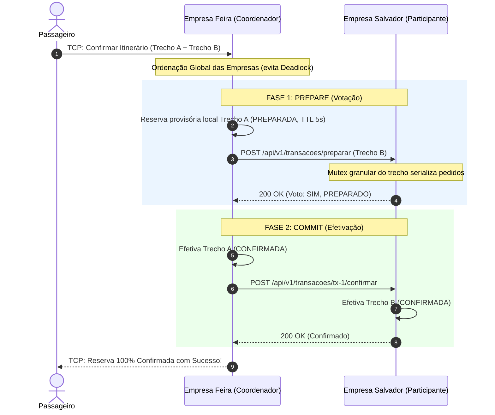
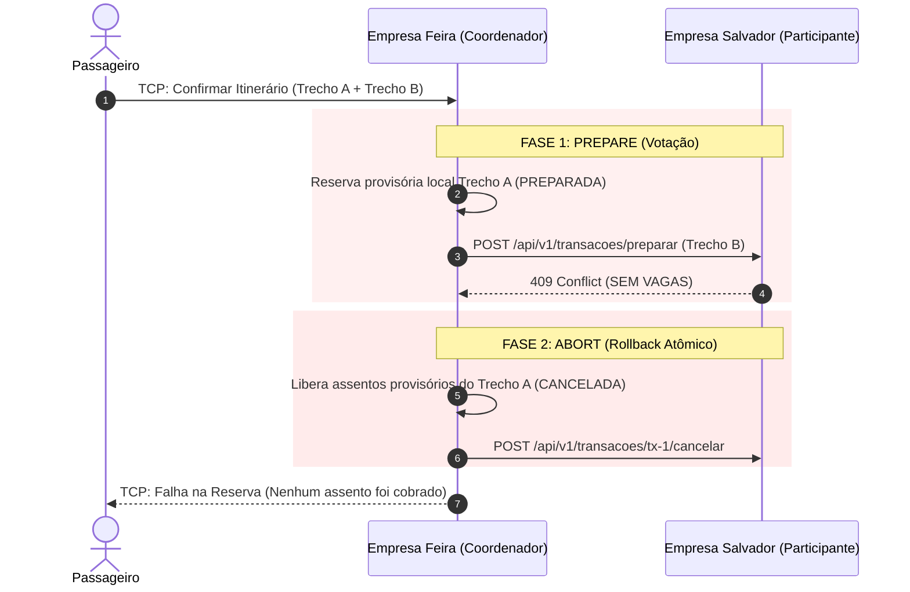

# Especificação da API REST — Consórcio VaiJunto (Problema 2)

Este documento descreve o contrato da API REST para a comunicação entre os servidores das empresas independentes do consórcio VaiJunto.

---

## 1. Princípios Arquiteturais

1. **Descentralização Total (P2P):** Não existe servidor central nem coordenador fixo. Todos os nós executam a mesma API e possuem as mesmas responsabilidades.
2. **Propriedade dos Dados:** Cada empresa é a autoridade exclusiva sobre suas próprias caronas e assentos. Nenhum servidor armazena dados privados de usuários de outras empresas.
3. **Padrão de Transporte:** Mensagens HTTP/1.1 com corpos em formato JSON (`Content-Type: application/json`).
4. **Tratamento de Datas:** Todas as datas e horários utilizam o formato universal ISO 8601 / RFC3339 (ex: `2026-10-30T14:30:00Z`).
5. **Valores Monetários:** Representados em números inteiros como centavos (`preco_centavos`) para evitar problemas de ponto flutuante.

---

## 2. Endpoints da API REST

### 2.1 Descoberta de Trechos Ativos

- **Rota:** `GET /api/v1/trechos`
- **Descrição:** Retorna a relação de trechos pertencentes a caronas ativas da empresa. Usado pelas outras empresas para alimentar o grafo de busca temporário.
- **Cabeçalhos de Requisição:**
  - `Accept: application/json`

#### Resposta de Sucesso (`200 OK`):
```json
[
  {
    "empresa_id": "empresa-a",
    "carona_id": "carona-101",
    "ordem": 0,
    "origem": "Feira de Santana",
    "destino": "Salvador",
    "capacidade": 4,
    "assentos_disponiveis": 3,
    "preco_centavos": 2000,
    "horario_saida": "2026-10-30T08:00:00Z",
    "horario_chegada": "2026-10-30T09:30:00Z"
  }
]
```

---

### 2.2 Fase 1 do 2PC: Preparação de Reserva (Prepare)

- **Rota:** `POST /api/v1/transacoes/preparar`
- **Descrição:** Bloqueia temporariamente os assentos especificados com um tempo de vida útil (TTL / Lease).
- **Corpo da Requisição (Payload):**
```json
{
  "transacao_id": "tx-feira-789",
  "passageiro_id": "passageiro-12",
  "quantidade_assentos": 1,
  "trechos": [
    {
      "empresa_id": "empresa-b",
      "carona_id": "carona-202",
      "ordem": 0
    }
  ],
  "ttl_ms": 5000
}
```

#### Respostas Possíveis:
- **`200 OK` (Voto SIM):** Assentos reservados provisoriamente.
  ```json
  {
    "sucesso": true,
    "mensagem": "preparado com sucesso"
  }
  ```
- **`409 Conflict` (Voto NÃO):** Sem vagas suficientes ou conflito de concorrência.
  ```json
  {
    "sucesso": false,
    "mensagem": "não há vagas suficientes em todos os trechos"
  }
  ```
- **`400 Bad Request`:** Payload malformado.

---

### 2.3 Fase 2 do 2PC: Confirmação Definitiva (Commit)

- **Rota:** `POST /api/v1/transacoes/{id}/confirmar`
- **Descrição:** Efetiva a reserva previamente preparada, mudando seu status para `confirmada`.
- **Idempotência:** Se a transação já estiver confirmada, retorna `200 OK` sem duplicar alterações.

#### Resposta de Sucesso (`200 OK`):
```json
{
  "sucesso": true,
  "mensagem": "transação confirmada"
}
```

---

### 2.4 Fase 2 do 2PC: Cancelamento / Rollback (Abort)

- **Rota:** `POST /api/v1/transacoes/{id}/cancelar`
- **Descrição:** Cancela a reserva preparada e devolve imediatamente os assentos ao catálogo da carona.
- **Idempotência:** Se a transação já foi cancelada ou expirou por TTL, retorna `200 OK`.

#### Resposta de Sucesso (`200 OK`):
```json
{
  "sucesso": true,
  "mensagem": "transação cancelada"
}
```

---

## 3. Diagrama de Sequência: Reserva Multiempresa com Sucesso

Exemplo de itinerário combinando **Trecho A (Empresa Feira)** e **Trecho B (Empresa Salvador)**:



---

## 4. Diagrama de Sequência: Falha e Rollback Atômico (Abort)

Cenário onde a Empresa Salvador está sem assentos suficientes no Trecho B:



---

## 5. Tolerância a Falhas e Timeouts

1. **Timeout Rápido:** Toda chamada HTTP entre empresas possui timeout estrito de 2 a 3 segundos. Se um servidor parceiro cair, o coordenador não fica travado e prossegue com o aborto seguro.
2. **Reserva Provisória com Lease (TTL):** Se o coordenador cair antes de enviar o Commit ou Abort, a empresa participante não mantém assentos bloqueados: o temporizador local de 5 segundos expira e libera os assentos automaticamente.
